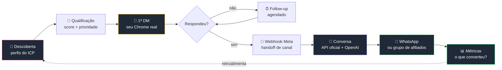

<div align="center">

# 🚀 Buscando 1 Milhão

### Um prompt. Um sistema comercial autônomo. Construído em público.

<br/>


<br/>


<br/>

## ⬇️ [**PROMPT.md**](PROMPT.md) ⬇️

**É esse arquivo. Preenche, cola no Codex, pronto.**

<br/>

**[O que é](#-o-que-é) · [Como funciona](#-como-funciona) · [Como usar](#-como-usar) · [Setup](#-setup-da-sua-máquina) · [Regras](#-regras-que-não-se-negocia)**

</div>

---

## Pipeline de cortes esportivos (Python)

O `pipeline_cortes.py` recebe uma URL de vídeo do YouTube ou um arquivo local, transcreve o áudio com timestamps via API da OpenAI, seleciona de 3 a 5 trechos de 45–65 segundos e renderiza vídeos verticais 1080×1920 com hook na tela. Os cortes, legendas e metadados são gravados em `outputs/cortes/`.

### Requisitos

- Python 3.10 ou superior
- FFmpeg e FFprobe instalados e disponíveis no `PATH`
- Chave da API da OpenAI com acesso ao modelo de transcrição e ao modelo configurado para análise
- Acesso autorizado ao arquivo e permissão para baixar, editar e publicar o conteúdo. Respeite direitos autorais e termos da plataforma.

O áudio é enviado à API da OpenAI para transcrição; isso pode gerar custos. O script não publica os vídeos automaticamente. Revise cortes, títulos e legendas antes de publicar.

### Instalação

```powershell
py -m venv .venv
.\.venv\Scripts\Activate.ps1
pip install -r requirements.txt
Copy-Item .env.example .env
```

Edite `.env` e configure `OPENAI_API_KEY` e `OPENAI_MODEL`. `TRANSCRIPTION_MODEL` usa `whisper-1` por padrão. Opcionalmente, indique uma fonte TrueType em `FONT_PATH`.

Instale o FFmpeg pelo gerenciador de pacotes do sistema e confirme que `ffmpeg` e `ffprobe` estão no `PATH`. No Windows, por exemplo, use `winget install Gyan.FFmpeg` e abra um novo terminal após a instalação.

### Uso

```powershell
python pipeline_cortes.py --input "https://www.youtube.com/watch?v=VIDEO_ID"
python pipeline_cortes.py --input "C:\Videos\entrevista.mp4" --layout crop
```

`--layout blur` (padrão) mantém o vídeo completo sobre um fundo desfocado. `--layout crop` preenche o quadro vertical com corte central. Para alterar a pasta de saída:

```powershell
python pipeline_cortes.py --input "C:\Videos\podcast.mp4" --output-dir "outputs\meus-cortes"
```

Cada vídeo `corte_XX.mp4` vem acompanhado por `corte_XX.txt` (hook e legenda) e os dados de todos os cortes ficam em `manifest.json`. O vídeo de origem precisa ter pelo menos 135 segundos para que o pipeline possa selecionar três cortes distintos. Erros de transcrição, seleção inválida ou ferramentas ausentes encerram a execução com uma mensagem explícita.

---

## 🎯 O que é

Um agente de IA que prospecta pelo Instagram sozinho: acha o lead, qualifica, escreve a primeira mensagem, entende a resposta, conduz a conversa, encaminha pro WhatsApp e **aprende com o que converteu** — ajustando público, texto, horário e cadência sem ninguém mandar.

Roda 100% local. Seu banco, sua sessão, sua chave.

```
Observar → Decidir → Agir → Medir → Aprender → Adaptar
```

Aqui **não tem código pronto**. Tem o prompt que constrói o código. Você troca os `{{PLACEHOLDERS}}` pelo seu negócio, cola no Codex, e sai um sistema seu — não uma cópia do meu.

<br/>

## ⚙️ Como funciona



### Por que dois canais

| Etapa | Canal | Motivo |
|:--|:--|:--|
| **Primeiro contato** | Seu Chrome, sua sessão | A API oficial da Meta **não abre** conversa com quem nunca te respondeu |
| **Depois da resposta** | API oficial + webhook | É o caminho suportado, auditável e estável |

Uma **trava de canal** garante que os dois nunca escrevam no mesmo fio. Depois do handoff, o navegador está proibido de responder.

<br/>

## 🚦 Como usar

### `1` Preenche o bloco de configuração

Abre o [**PROMPT.md**](PROMPT.md). No topo tem um bloco `CONFIGURAÇÃO` com uns 15 campos. Troca cada `{{PLACEHOLDER}}` pelo seu: nome, empresa, site, @ do Instagram, WhatsApp, oferta e quem é seu cliente ideal.

Dois campos merecem atenção:

- **`VERIFIED_CLAIMS`** — só o que você consegue provar hoje. É a única coisa que a IA pode afirmar pro lead.
- **`UNVERIFIED_CLAIMS`** — o que você *quer* dizer mas ainda não comprovou. Fica bloqueado até virar prova.

### `2` Cola no Codex

Copia o arquivo inteiro, do começo ao fim, e cola numa task do Codex.

> 💡 Codex cloud roda em container — ele **escreve** toda a camada de navegador e testa contra páginas simuladas, mas não alcança o seu Chrome. O prompt já diz isso pra ele, então ele entrega tudo e deixa o teste real documentado pra você rodar local.

### `3` Roda na sua máquina

Clona o que ele gerou, faz o [setup abaixo](#-setup-da-sua-máquina), e sobe:

```bash
pnpm install && pnpm dev
```

<br/>

## 🔧 Setup da sua máquina

<details>
<summary><b>🔑 Chave da OpenAI</b></summary>

<br/>

1. **https://platform.openai.com/api-keys** → login.
2. **Settings → Billing**: adiciona crédito. Sem crédito, dá `429 insufficient_quota`.
3. **Settings → Limits**: define um **hard limit** mensal (ex. `USD 50`). Esse é o freio real se o agente entrar em loop.
4. **Create new secret key** → projeto **separado** (não usa o `Default`) → permissão `Restricted`, só `Model capabilities: Write`.
5. Copia a chave **agora**, ela só aparece uma vez.

```bash
cp .env.example .env
# cola em OPENAI_API_KEY=sk-proj-...
```

O `.env` já está no `.gitignore`. Nunca commita, nunca aparece em print ou vídeo.

**Vazou?** Revoga em `platform.openai.com/api-keys` e gera outra. Revogar resolve — reescrever o histórico do Git é secundário.

</details>

<details>
<summary><b>🌐 Sessão do Instagram no seu Chrome</b></summary>

<br/>

Perfil **dedicado**, separado do seu pessoal. Isso resolve três coisas de uma vez: o agente nunca vê suas abas, seu Chrome normal continua livre, e o Chrome 136+ recusa debug no perfil padrão de qualquer jeito.

**macOS**

```bash
/Applications/Google\ Chrome.app/Contents/MacOS/Google\ Chrome \
  --remote-debugging-port=9222 \
  --remote-debugging-address=127.0.0.1 \
  --user-data-dir="$PWD/.chrome-profile"
```

**Linux**

```bash
google-chrome --remote-debugging-port=9222 --user-data-dir="$PWD/.chrome-profile"
```

**Windows (PowerShell)**

```powershell
& "C:\Program Files\Google\Chrome\Application\chrome.exe" `
  --remote-debugging-port=9222 `
  --user-data-dir="$PWD\.chrome-profile"
```

Nessa janela que abriu, entra no `instagram.com`, loga normal, resolve o 2FA. A sessão fica salva e sobrevive a reinício.

Testa:

```bash
curl -s http://127.0.0.1:9222/json/version
```

> ⚠️ **Segurança:** essa porta dá controle total sobre a sessão logada nesse perfil. Mantém em `127.0.0.1`, nunca `0.0.0.0`, e não roda em máquina compartilhada. O `.chrome-profile/` guarda seus cookies do Instagram — já está no `.gitignore` e não sai da sua máquina.

</details>

<br/>

## 🛡️ Regras que não se negocia

<details>
<summary><b>Como o agente não queima a conta</b></summary>

<br/>

| Controle | Padrão |
|:--|:--|
| DMs por dia | 30, com aquecimento gradual |
| Intervalo entre DMs | 90–240s aleatório |
| Janela de operação | 09:00–20:00, fuso configurável |
| Circuit breaker | Pausa tudo em erro anormal, restrição ou opt-out em alta |

Ritmo humano existe por **saúde da conta** — mesma disciplina de um SDR de verdade. Não tem fingerprint forjado, API privada nem tentativa de burlar bloqueio.

</details>

<details>
<summary><b>Como o agente não mente</b></summary>

<br/>

A IA só pode afirmar o que está em `VERIFIED_CLAIMS`. Qualquer coisa em `UNVERIFIED_CLAIMS` fica bloqueada até virar prova.

Ela nunca inventa taxa, condição, garantia ou superlativo, nunca promete aprovação de conta, e nunca finge ser cliente pra arrancar resposta.

</details>

<details>
<summary><b>Como o agente respeita quem não quer</b></summary>

<br/>

Pedido de parar é atendido na hora. O perfil entra em `do_not_contact` — permanente, sem follow-up, sem reentrada por outra campanha, por nenhum canal.

</details>

<details>
<summary><b>Como o custo não explode</b></summary>

<br/>

Toda chamada à OpenAI grava tokens e custo. Ao bater `OPENAI_MONTHLY_BUDGET_USD`, o sistema pausa sozinho.

O painel mostra **custo por lead** e **custo por cliente ativo** — sem isso não dá pra saber se a automação dá lucro.

</details>

<br/>

---

<div align="center">

**Este repositório é público de propósito.**

Pega o [PROMPT.md](PROMPT.md), troca os `{{PLACEHOLDERS}}`, e constrói o seu.

<br/>

⭐ Se isso te ajudou, deixa uma estrela e acompanha a jornada.

</div>
